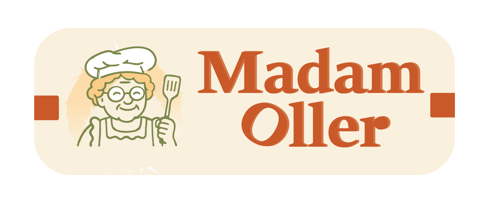
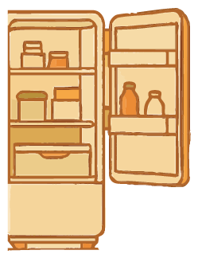
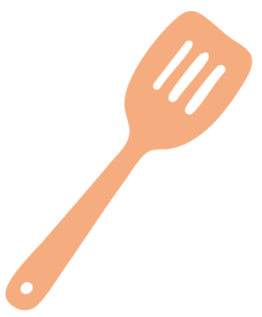
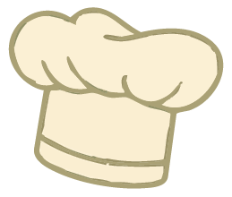
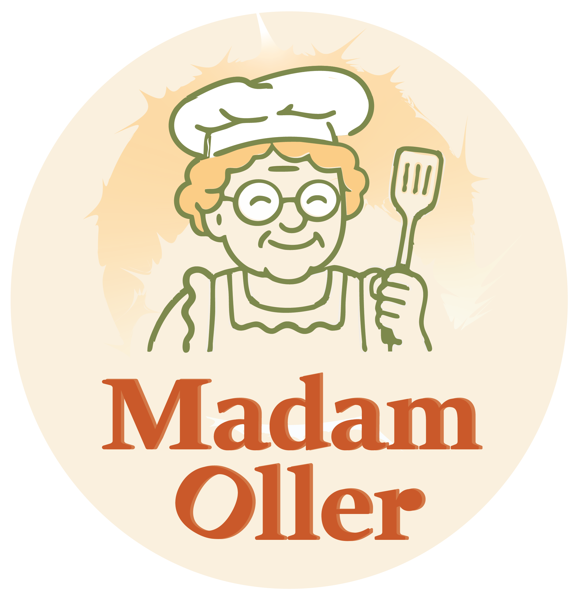

<div align="center">



# Manual de Identidade Visual & Design System — Madam Oller

**Guia oficial de diretrizes visuais, tokens de design de frontend e arquitetura de componentes da plataforma Madam Oller.**

[](#)
[](#)
[](#)
[](#)

[Identidade & Conceito](#-1-conceito-da-marca--personalidade) •
[Tokens de Cores Semânticas](#-2-paleta-de-cores--design-tokens-frontend) •
[Tipografia & Escala](#-3-tipografia--hierarquia-de-texto) •
[Iconografia & Elementos Culinários](#-4-iconografia--elementos-culinários-proprietários) •
[Componentes & Estados Nutricionais](#-5-componentes-de-ui--estados-nutricionais) •
[Diretrizes de Implementação](#-6-diretrizes-de-código-e-estilo)

</div>

---

## 👵 1. Conceito da Marca & Personalidade

O **Madam Oller** foi concebido a partir de um arquétipo caloroso e reconfortante: a figura da **avó cozinheira** — detentora do afeto, dos segredos da culinária caseira e da capacidade de transformar o que está na geladeira em uma refeição memorável.

Essa alma tradicional e rústica é combinada de forma deliberada com **engenharia de software de ponta, visão computacional e inteligência artificial**. O resultado é uma identidade visual que equilibra:

* **Tradição & Calor Afetivo:** Tons terrosos, cerâmica quente, papel kraft e ilustrações orgânicas que eliminam a frieza de aplicativos médicos ou de contagem estrita de calorias.
* **Precisão Científica & Nitidez Digital:** Gráficos concêntricos, velocímetros de semáforo nutricional com cores de contraste padronizadas (WCAG AA) e tipografia geométrica de alta legibilidade para números e gramaturas em telas de smartphones.

```
       [ Tradição / Afeto Culinário ]  ◄─── MADAM OLLER ───►  [ Precisão Algorítmica / IA ]
        • Terracota & Creme Warm                               • Gráficos Concêntricos & Métricas
        • Ilustrações Manuais Vetoriais                        • Leituras EAN a 60fps em WebAssembly
        • Sensação de Cozinha de Casa                          • Fichas Técnicas USDA / Análise Bromatológica
```

---

## 🎨 2. Paleta de Cores & Design Tokens (Frontend)

O Design System traduz a identidade visual em **Design Tokens semânticos** baseados em variáveis CSS puras (`var(--token)`), garantindo coerência em todas as telas e prevenindo divergências visuais no frontend.

### 2.1 Cores Primárias da Marca (Brand Tokens)

| Amostra | Nome do Token | Código Hex | Variável CSS | Função / Uso no Frontend |
| :---: | :--- | :---: | :--- | :--- |
|  | **Terracota Oller (Primary)** | `#C85829` | `--clr-primary`<br>`--clr-accent` | Ações principais, CTAs primários, anel ativo de calorias, bordas de destaque e logomarca. |
|  | **Terracota Deep (Hover/Active)** | `#A7461F` | `--clr-accent-dark` | Estado `:hover` e `:active` de botões, cabeçalhos de tabelas e links interativos. |
|  | **Creme Culinário (Background)** | `#F5E7CE` | `--clr-bg` | Tom de fundo acolhedor de páginas e modais, reduzindo fadiga ocular em cozinhas. |
|  | **Grafite Profundo (Body Text)** | `#2E2E2E` | `--clr-text` | Tipografia de texto corrido, garantindo contraste superior a 10:1 sobre o fundo creme. |
|  | **Verde Oliva (Success/Match)** | `#868F54` | `--clr-success` | Badges de estoque (`NA DESPENSA`), validação de harmonia sensorial e receitas prontas. |
|  | **Laranja Solar (Highlight)** | `#F28C28` | `--brand-orange` | Badges especiais, destaque de alertas informativos e selos de quarentena de produtos B2B. |

### 2.2 Cores Funcionais de Semáforo & Nutrição (Dashboard Tokens)

Os velocímetros de macronutrientes e os relatórios de ingestão utilizam uma codificação cromática inequívoca:

| Amostra | Propósito Semântico | Hexadecimal | Variável / Classe | Regra de Negócio Nutricional |
| :---: | :--- | :---: | :--- | :--- |
|  | **Dentro da Meta / Alvo Atingido** | `#16A34A` | `--clr-status-optimal` | Ingestão dentro de ±10% da meta clínica ou saldo em déficit programado. |
|  | **Atenção / Próximo ao Limite** | `#EAB308` | `--clr-status-warning` | Macronutriente atingindo 90–100% da faixa recomendada. |
|  | **Excesso / Limite Ultrapassado** | `#DC2626` | `--clr-status-danger` | Gorduras trans/saturadas acima do teto OMS ou saldo calórico extrapolado (`PASSOU XX KCAL`). |
|  | **Hidratação & Água** | `#0284C7` | `--clr-status-water` | Medidor de ingestão hídrica em ml e feedback de hidratação. |
|  | **Fibras & Micronutrientes** | `#A855F7` | `--clr-status-fiber` | Indicador de fibras alimentares e minerais essenciais. |

### 2.3 Snippet Oficial de Design Tokens (`styles.css`)

```css
:root {
    /* Brand Primary & Accents */
    --clr-primary: #c85829;
    --clr-accent: #c85829;
    --clr-accent-dark: #a7461f;
    --brand-orange: #f28c28;

    /* Backgrounds & Canvas */
    --clr-bg: #f5e7ce;
    --clr-bg-card: #ffffff;
    --clr-bg-subtle: #f8fafc;
    --clr-border: #cccccc;
    --clr-shadow: rgba(0, 0, 0, 0.08);

    /* Text & Legibility */
    --clr-text: #2e2e2e;
    --clr-text-muted: #64748b;
    --clr-footer-text: #6a2b1b;

    /* Semantic Nutrition & Status Feedback */
    --clr-success: #868f54;
    --clr-status-optimal: #16a34a;
    --clr-status-warning: #eab308;
    --clr-status-danger: #dc2626;
    --clr-status-water: #0284c7;

    /* Radii & Elevation */
    --radius: 8px;
    --radius-lg: 16px;
    --shadow-soft: 0 4px 14px rgba(0, 0, 0, 0.07);
    --shadow-floating: 0 10px 25px -5px rgba(200, 88, 41, 0.2);
}
```

---

## 🔤 3. Tipografia & Hierarquia de Texto

A tipografia do Madam Oller foi selecionada para balancear a **personalidade acolhedora da cozinha** com a **legibilidade escaneável** de dados técnicos de nutrição em telas mobile de 360px a 420px.

```
       HEADINGS & TÍTULOS                         CORPO, INGREDIENTES & MÉTRICAS
      Fonte: 'Saira', sans-serif                      Fonte: 'Sitka' / 'Segoe UI'
        Moderna, condensada,                          Alta legibilidade, números
      impactante em títulos mobile                     claros em tabelas e listas
```

### 3.1 Famílias Tipográficas

1. **Heading & UI Navigation (`--ff-heading`): `'Saira', -apple-system, sans-serif`**
   * Usada em títulos de seções, modais, números de calorias proeminentes e navegação.
   * *Por que foi escolhida:* Seus caracteres condensados e peso firme permitem títulos expressivos sem quebrar linhas em telas pequenas de smartphones.
2. **Body & Mise en Place (`--ff-body`): `'Sitka', Georgia, serif`**
   * Usada para modo de preparo de receitas, descrições institucionais e notas da comunidade.
   * *Por que foi escolhida:* Traz o tom clássico de cadernos tradicionais de receita, conferindo calor e elegância à leitura.
3. **Data & Metrics (Tabelas de Macros / Diário): `'Segoe UI', 'Roboto', sans-serif`**
   * Usada para pesos, gramaturas (`75 g`), calorias (`200 kcal`) e valores de TMB.
   * *Por que foi escolhida:* Glifos numéricos neutros e claros evitam qualquer ambiguidade de leitura na balança.

### 3.2 Escala Tipográfica Relativa

| Token | Tamanho | Peso | Uso Típico |
| :--- | :---: | :---: | :--- |
| `--fs-800` | `2.50rem` (40px) | `700` | Números centrais do anel calórico (`RESTAM 379 KCAL`). |
| `--fs-700` | `2.00rem` (32px) | `700` | Títulos principais de páginas e cabeçalhos de receitas. |
| `--fs-600` | `1.50rem` (24px) | `600` | Títulos de cards de refeição (*Almoço, Café da Manhã*). |
| `--fs-500` | `1.25rem` (20px) | `600` | Nomes de macros nos velocímetros e subtítulos de seções. |
| `--fs-400` | `1.00rem` (16px) | `400 / 500` | Texto de ingredientes do *Mise en Place* e instruções de preparo. |
| `--fs-300` | `0.85rem` (13.6px)| `400` | Badges de status, rótulos de fontes científicas (*USDA*) e notas. |

---

## 🍳 4. Iconografia & Elementos Culinários Proprietários

O design system conta com uma biblioteca de ícones proprietários de temática gastronômica e funcional, garantindo uma identidade visual autoral e diferenciada de ícones genéricos de mercado:

| Ícone | Asset Vetorial / Web | Papel na Plataforma |
| :---: | :--- | :--- |
|  | `docs/brand/icon-pantry.png`<br>`Geladeira-01.svg` | **Minha Despensa Virtual:** Representa o estoque doméstico e o ponto de partida do algoritmo de busca de receitas. |
|  | `docs/brand/icon-chef.png`<br>`Favicon Espatula Final.ai` | **Chef IA / Preparo:** Representa o motor de geração de receitas e harmonização culinária. |
|  | `docs/brand/icon-hat.png`<br>`Chapéu.svg` | **Academia Culinária & Técnicas:** Representa o aprendizado gastronômico, vídeos tutoriais e pontuação em XP. |
|  | `docs/brand/icon-diary.png` | **Meu Diário & Macros:** Representa o registro diário de refeições, balanço energético e hidratação. |
|  | `docs/brand/logo-symbol-circular.png` | **Selo Oficial de Homologação:** Aplicado em receitas validadas pela equipe e certificação de produtos de marcas parceiras. |

---

## 📊 5. Componentes de UI & Estados Nutricionais

### 5.1 O Anel Concêntrico Duplo de Energia & Atividade

O componente central do diário alimentar sintetiza ingestão e queima calórica através de geometria visual intuitiva:

* **Anel Externo (Verde / Vermelho):** Representa o balanço líquido de calorias. Permanece verde em déficit calórico saudável; transiciona para vermelho vibrante (`#DC2626`) caso o teto diário seja ultrapassado.
* **Anel Interno (Terracota):** Representa o volume calórico total ingerido em relação à Taxa Metabólica Basal (`TMB`).
* **Tooltip Flutuante:** Desmembra deterministicamente:
  $$\text{Consumido} - \text{Gasto Total (TMB + Treinos)} = \text{Saldo Alvo}$$

### 5.2 Badges de Despensa e Insumos

```
┌─────────────────────────────────┐
│ [✔ 2/2 despensa]               │  <-- Selo Verde: Receita 100% pronta para cozinhar agora
└─────────────────────────────────┘
┌─────────────────────────────────┐
│ [✔ 2/5 despensa]               │  <-- Selo Amarelo/Neutro: Faltam itens (botão de compra ativado)
└─────────────────────────────────┘
┌─────────────────────────────────┐
│ [NA DESPENSA]                   │  <-- Badge de item já marcado no Mise en Place
└─────────────────────────────────┘
┌─────────────────────────────────┐
│ [(patrocinado)] + Logo da Marca │  <-- Injeção nativa de Retail Media no ingrediente
└─────────────────────────────────┘
```

---

## 💻 6. Diretrizes de Código e Estilo (Frontend Architecture)

Para manter a consistência e a velocidade de renderização em dispositivos móveis, o frontend do projeto segue três regras rígidas:

1. **CSS Externo Centralizado:**
   É proibido o uso de tags `<style>` inline dentro de templates Django. Todo estilo novo deve reutilizar as variáveis semânticas de `static/css/styles.css`.
2. **Responsividade Mobile-Only sem Quebra de Layout:**
   Ajustes específicos para dispositivos móveis são restritos a media queries limitadoras ao final da folha de estilos:
   ```css
   @media (max-width: 768px) {
       /* Adaptações de densidade sem afetar a grade desktop */
   }
   ```
3. **Optimistic UI com Feedback Háptico:**
   Mutações de interface (como marcar um alimento no diário ou favoritar uma receita) devem atualizar o DOM no mesmo frame de animação (`<16ms`), acionar `navigator.vibrate(50)` quando compatível e persistir a requisição em background via `IndexedDB` (`localForage`).

---

<div align="center">

**Madam Oller Design System • Versão 1.2**  
*Desenvolvido para criar experiências culinárias e nutricionais humanas, científicas e acolhedoras.*

</div>
