<div align="center">


# Madam Oller — AI Culinary, Precision Nutrition & Retail Media Ecosystem

**Plataforma Phygital (B2C • B2B2C • B2B) que conecta a despensa real do consumidor, geração inteligente de receitas por IA, acompanhamento clínico/esportivo de precisão e inteligência de dados para a indústria alimentícia.**

[](#)
[](#)
[](#)
[](#)
[](#)
[](#)
[](#)

[Proposta de Valor](#-proposta-de-valor--o-problema-resolvido) •
[Destaques Visuais](#-galeria-em-destaque-hero-showcase) •
[Tour pelos Módulos](#-tour-completo-pelos-módulos-28-telas) •
[Arquitetura & Fluxo](#-arquitetura-do-sistema--fluxo-de-dados) •
[Matriz de Funcionalidades](#-matriz-de-módulos-e-capacidades) •
[Decisões de Engenharia (ADRs)](#-decisões-de-arquitetura--engenharia-adrs)

</div>

---

## 🎯 Proposta de Valor & O Problema Resolvido

O ecossistema **Madam Oller** foi projetado para resolver uma desconexão estrutural que afeta três pontas da cadeia de alimentação e saúde:

1. **Na Cozinha do Consumidor (B2C) — Desperdício e Fadiga de Decisão:**
   Milhões de consumidores compram ingredientes que acabam esquecidos na despensa por falta de repertório culinário prático. Ao mesmo tempo, aplicativos tradicionais de dieta exigem que o usuário adapte sua rotina a cardápios engessados, enquanto geradores genéricos de receitas ignoram completamente as metas de macronutrientes, micronutrientes e o estoque real da casa.
2. **No Consultório e na Academia (B2B2C) — Baixa Adesão e o "Ponto Cego Nutricional":**
   * **Nutricionistas** prescrevem planos alimentares estáticos que perdem adesão na primeira semana porque o paciente não sabe substituir pratos com o que tem na geladeira sem furar os macros estipulados.
   * **Personal Trainers** prescrevem treinos de alta precisão, mas operam no escuro sem saber se a estagnação do aluno decorre do estímulo físico ou de um déficit proteico/superávit calórico não relatado no fim de semana.
3. **Na Gôndola da Indústria Alimentícia (B2B) — Cegueira Pós-Checkout e Receitas Estáticas:**
   Marcas de bens de consumo (CPG) investem milhões para colocar produtos no carrinho do consumidor, mas perdem totalmente a rastreabilidade após o caixa do supermercado. As receitas impressas nas embalagens são estáticas e raramente executadas porque o consumidor não possui os demais ingredientes necessários em casa.

### 💡 A Solução Madam Oller

Uma plataforma unificada **Offline-First (PWA)** onde:
* O usuário gerencia sua **Despensa Virtual** (via toque rápido ou **Scanner de Código de Barras EAN em WebAssembly**) e recebe receitas geradas e auditadas que cruzam o estoque disponível em casa com seu orçamento calórico e metas de saúde.
* Uma **Calculadora Reversa de Porções** converte instantaneamente quantas calorias o usuário pode ingerir naquela refeição no peso exato em gramas que ele deve servir na balança.
* **Nutricionistas e Personal Trainers** conectam-se à conta do paciente/aluno em tempo real, injetando metas clínicas, ingredientes obrigatórios na IA, pastas de receitas com cálculo automático de lista de compras e treinos parametrizados por gasto metabólico (**METs**).
* **Marcas de Alimentos** transformam o código de barras físico de suas embalagens em um **Hub Digital de Receitas Dinâmico**, acessam inteligência de co-ocorrência de despensa (**Pantry Analytics**) e patrocinam ingredientes de forma nativa no momento exato do preparo (**Retail Media na Cozinha**).

---

## ✨ Galeria em Destaque (Hero Showcase)

Os três fluxos abaixo sintetizam a convergência entre **Engenharia Nutricional**, **Autonomia Culinária** e **Visão Computacional Phygital**:

| 1. Balanço Metabólico Integrado (B2C/B2B2C) | 2. Calculadora Reversa & Match de Despensa | 3. Scanner EAN Proprietário (WASM) & Retail Media |
| :---: | :---: | :---: |
| 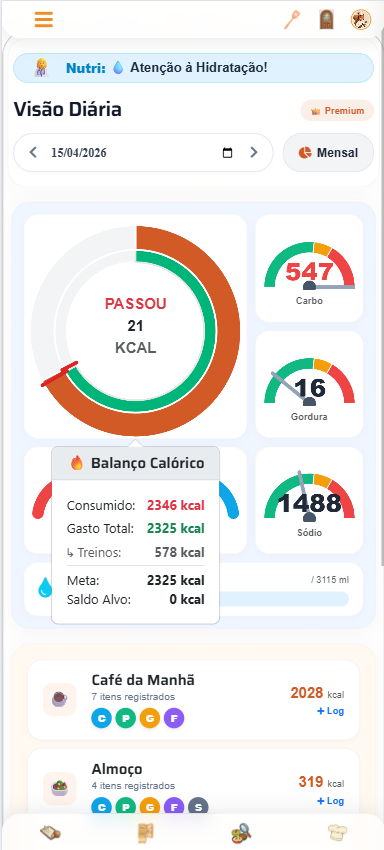 | 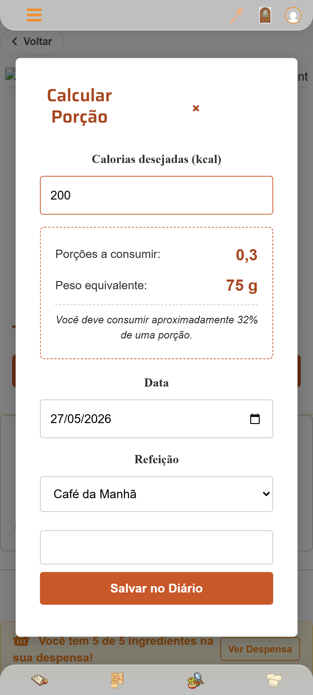 | 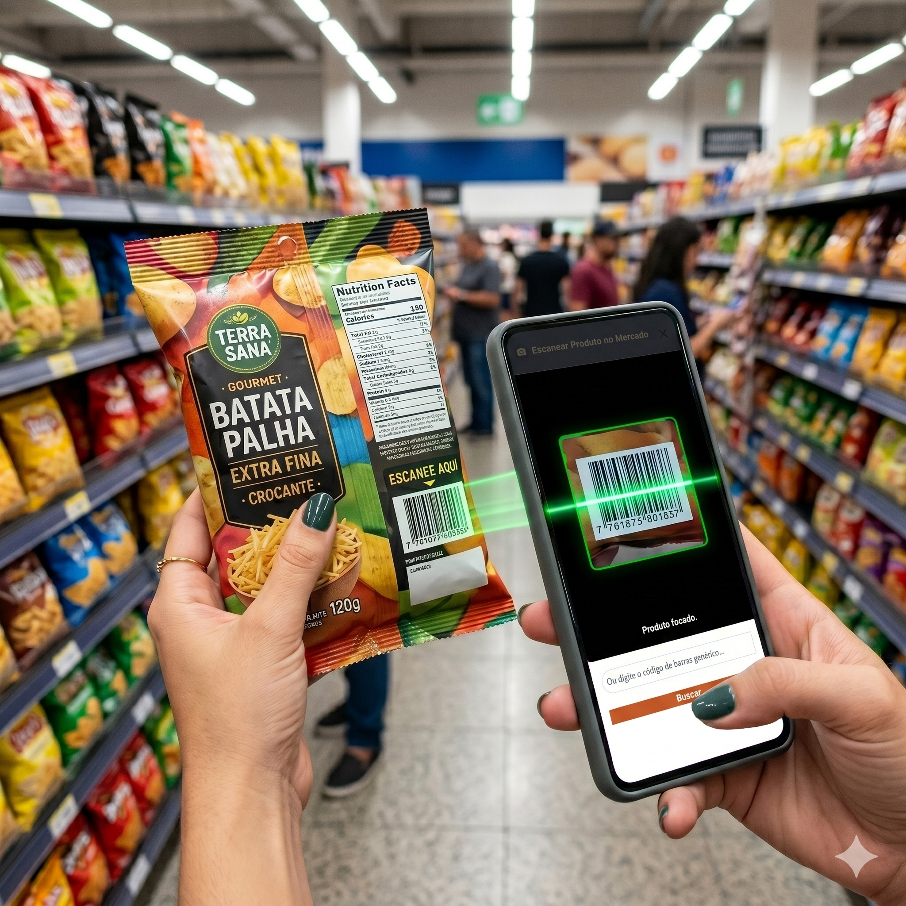 |
| **Diário Dinâmico em Tempo Real:** Anel concêntrico duplo que cruza consumo alimentar com a Taxa Metabólica Basal (*Mifflin-St. Jeor*) + calorias queimadas nos treinos prescritos (`578 kcal`), exibindo velocímetros de macros/sódio e *tags* motivacionais enviadas ao vivo pela Nutricionista (`💧 Atenção à Hidratação!`). | **Precisão Matemática na Balança:** O usuário informa quantas calorias deseja consumir no prato (`200 kcal`) e o motor calcula instantaneamente a fração exata da receita (`0,3 porção`) e o peso equivalente (`75 g`), validando no rodapé a disponibilidade imediata dos itens (`5 de 5 ingredientes na sua despensa!`). | **Ponte Físico-Digital (Phygital):** SDK proprietário em *WebAssembly* capaz de decodificar códigos de barras EAN em embalagens plásticas curvas, amassadas e reflexivas no supermercado, abrindo o livro de receitas da marca filtrado pelo que o cliente já tem em casa. |

---

## 📱 Tour Completo pelos Módulos (28 Telas)

Explore a arquitetura visual e funcional de cada vertical do produto expandindo as seções abaixo. *(Nota: Todos os dados exibidos pertencem a perfis e marcas fictícias gerados para homologação e showcase).*

<details>
<summary><b>🥗 1. Módulo B2C Core & Premium — Nutrição de Precisão, Micronutrientes e Lista de Compras Unificada (9 Telas)</b></summary>
<br>

| Visão Diária & Hidratação | Semáforo Mensal OMS/ANVISA | Recomendação Reversa (Micronutrientes) |
| :---: | :---: | :---: |
| 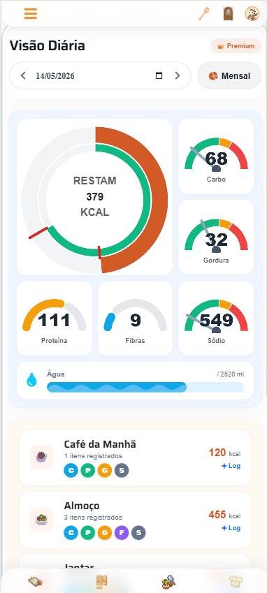 | 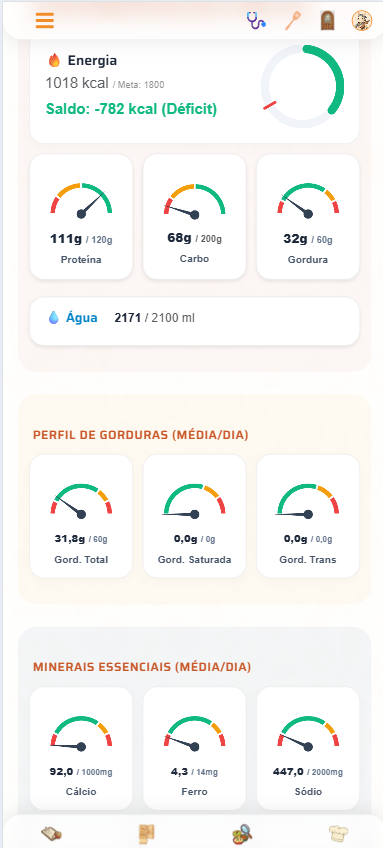 | 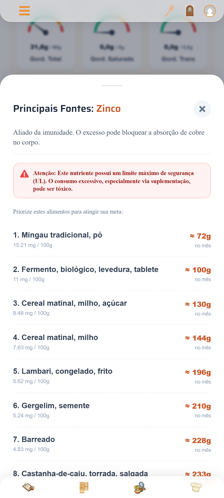 |
| **Controle Diário Sem Fricção:** Monitoramento visual de saldo calórico restante (`Restam 379 kcal`), velocímetros independentes para Carboidratos, Gorduras, Proteínas, Fibras e Sódio, barra fluida de meta hídrica (`2520 ml`) e cartões de refeições com selos rápidos de composição. | **Auditoria de 30 Dias:** Consolidação mensal do déficit/superávit energético médio, perfil lipídico detalhado (Gordura Total, Saturada e Trans) e rastreamento de minerais essenciais (Cálcio, Ferro, Sódio) parametrizados por diretrizes científicas. | **Ação Corretiva Baseada em Dados:** Ao clicar em um micronutriente em déficit (ex: *Zinco*), o motor consulta a base científica, exibe alertas de limite de segurança biológica (*Upper Limit*) e ranqueia os alimentos com maior biodisponibilidade e a gramatura mensal necessária. |

| Ficha de Receita & Macros | Mise en Place & Estoque Local | Auditoria Científica USDA |
| :---: | :---: | :---: |
| 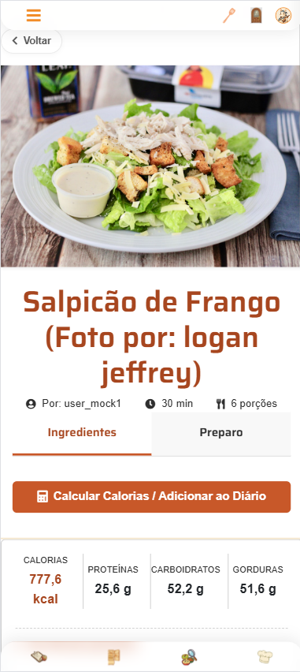 | 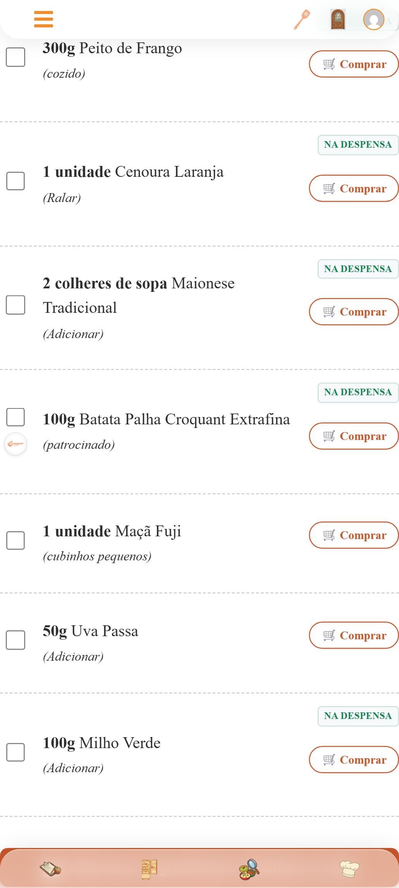 | 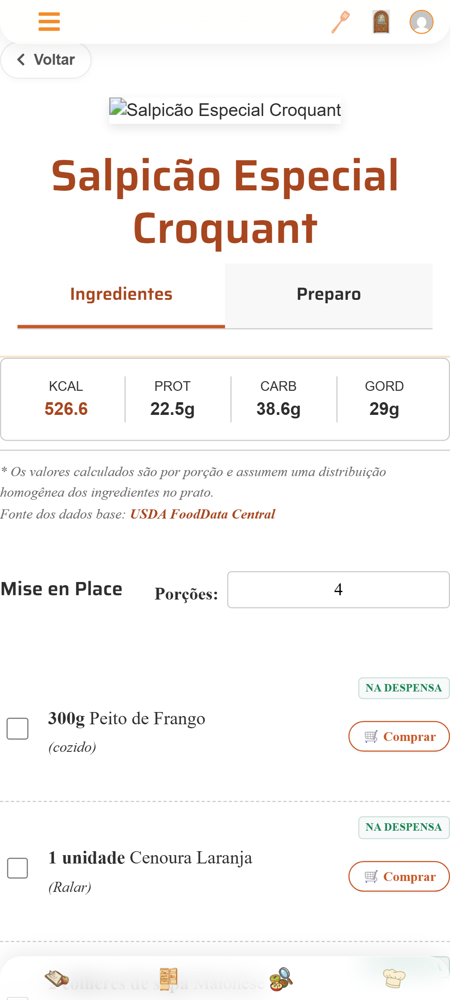 |
| **Transparência Nutricional:** Cálculo automático de calorias, proteínas, carboidratos e gorduras por porção a partir da soma ponderada de ingredientes e temperos, integrado diretamente ao botão de cálculo reverso e registro no diário. | **Mise en Place Conectado à Despensa:** Checklist interativo de preparo que identifica automaticamente quais insumos já estão disponíveis na casa do usuário (`NA DESPENSA`) e permite enviar itens faltantes para a lista de compras com um toque. | **Rastreabilidade Científica:** Cabeçalho técnico com recálculo dinâmico de porções e referência explícita à fonte bromatológica (*USDA FoodData Central / TACO*), eliminando estimativas subjetivas. |

| Planejador Semanal & Carga Prescrita | Lista de Compras Unificada (Soma Algébrica) |
| :---: | :---: |
| 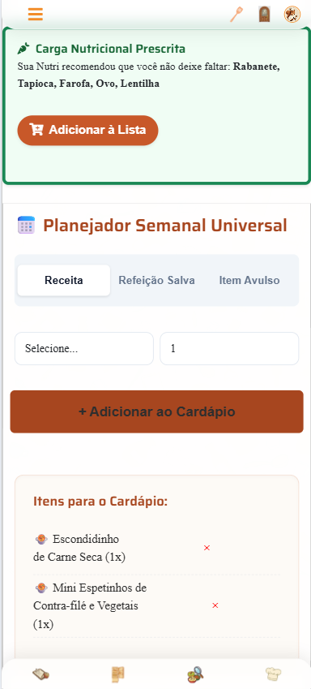 | 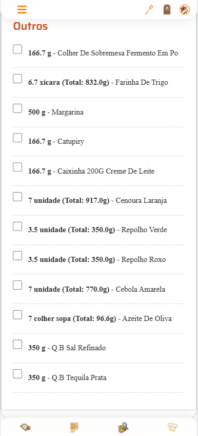 |
| **Planejamento Guiado pela Clínica:** O usuário monta o cardápio da semana combinando receitas, refeições salvas e itens avulsos, enquanto visualiza no topo a **Carga Nutricional Prescrita** pela sua nutricionista (ex: *Rabanete, Tapioca, Farofa, Ovo, Lentilha*) para adição imediata. | **Consolidação e Conversão de Unidades:** O algoritmo agrega todos os ingredientes de todas as receitas planejadas na semana, normalizando medidas caseiras heterogêneas em unidades práticas de compra acompanhadas da gramatura exata total (ex: `6.7 xícaras (Total: 832.0g) - Farinha de Trigo`). |

</details>

<details>
<summary><b>🩺 2. Módulo B2B2C Saúde — Consultório Digital do Nutricionista & Prescrição Ativa (4 Telas)</b></summary>
<br>

| Dashboard Clínico de Pacientes | Raio-X Semanal (Read-Only) | Biblioteca de Protocolos Clínicos | Pasta Prescrita no App do Paciente |
| :---: | :---: | :---: | :---: |
| 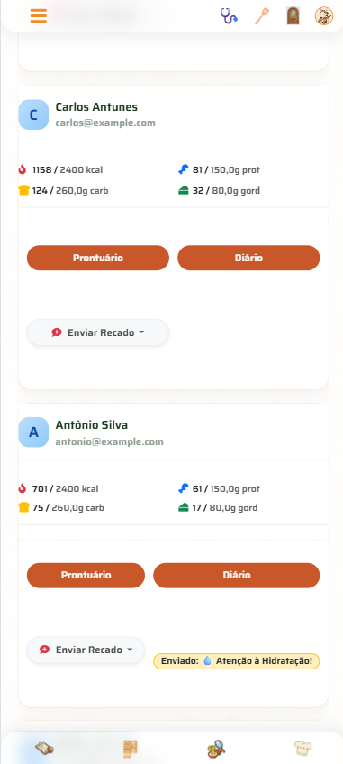 | 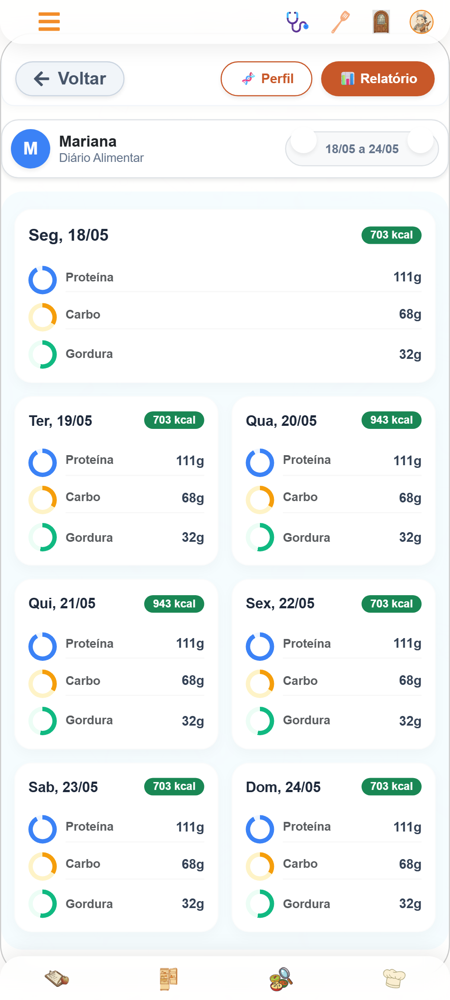 | 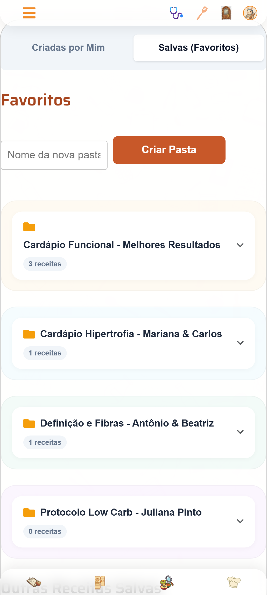 | 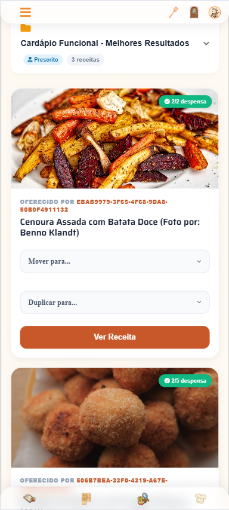 |
| **Monitoramento Vivo da Carteira:** Visão consolidada dos pacientes ativos com consumo em tempo real vs. metas prescritas (`1158 / 2400 kcal`, `81 / 150g prot`), acesso rápido ao prontuário e disparo instantâneo de *Tags Motivacionais* que aparecem no topo do app do paciente. | **Auditoria Semanal sem Fricção:** O profissional navega pela semana do paciente (`Seg` a `Dom`) visualizando a consistência calórica e a distribuição de macronutrientes em anéis gráficos antes mesmo da consulta de retorno. | **Laboratório de Cardápios:** Criação de pastas temáticas por objetivo clínico (*Cardápio Funcional*, *Hipertrofia*, *Definição e Fibras*, *Protocolo Low Carb*) para compartilhamento seletivo com pacientes vinculados. | **Prescrição Conectada à Geladeira:** O paciente recebe a pasta prescrita pelo nutricionista com o selo oficial `Prescrito` e badges dinâmicos (`2/2 despensa`, `2/5 despensa`) que mostram quais receitas do plano ele já pode cozinhar imediatamente hoje. |

</details>

<details>
<summary><b>🏋️ 3. Módulo B2B2C Fitness — Hub do Personal Trainer, "Tabela da Verdade" e Workout Builder (5 Telas)</b></summary>
<br>

| Gestão de Carteira de Alunos | "Tabela da Verdade" (7 Dias) | Workout Builder Pro (METs) |
| :---: | :---: | :---: |
| 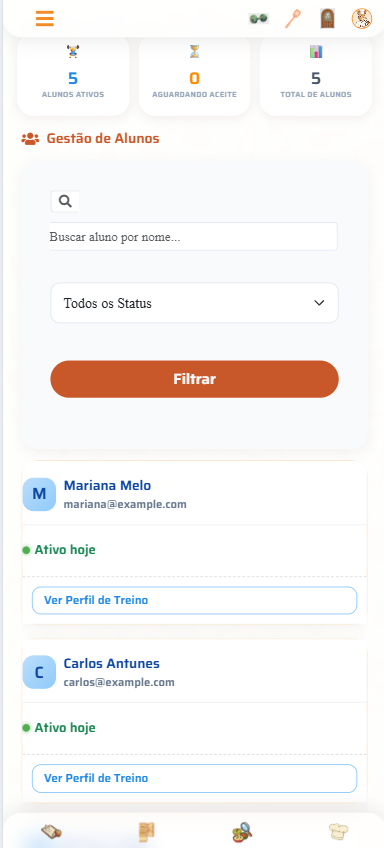 | 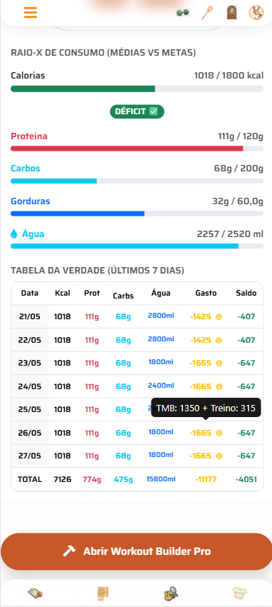 | 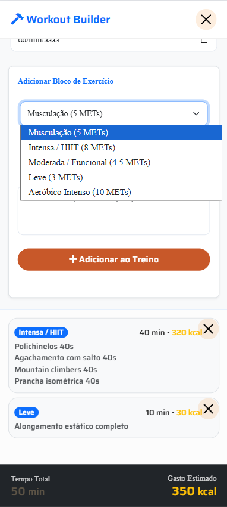 |
| **Retenção e Engajamento:** Painel com indicadores de alunos ativos, convites pendentes, filtros de status e sinalização em tempo real de presença diária (`Ativo hoje`). | **Fim do Ponto Cego Nutricional:** Espelhamento da rotina alimentar do aluno cruzando médias vs. metas e uma matriz diária de 7 dias com Kcal ingeridas, Proteínas, Carbos, Água, Gasto Total decomposto (`TMB: 1350 + Treino: 315`) e Saldo Calórico líquido. | **Prescrição Parametrizada por METs:** Construtor de fichas de treino onde cada bloco é classificado por seu Equivalente Metabólico (*Musculação 5 METs*, *HIIT 8 METs*, *Aeróbico Intenso 10 METs*), calculando instantaneamente o gasto energético estimado (`350 kcal` em `50 min`) com base no peso real do aluno. |

| Prontuário de Biometria & Hipertrofia | Histórico Auditável de Treinos |
| :---: | :---: |
| 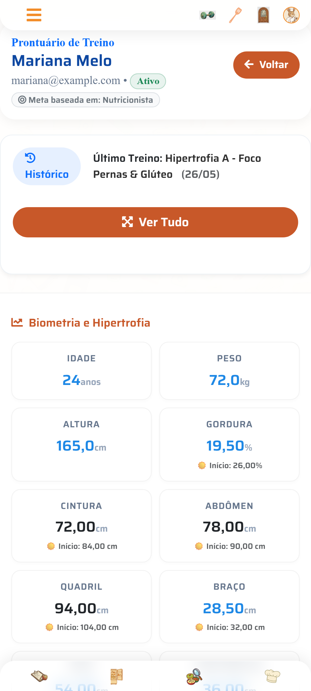 | 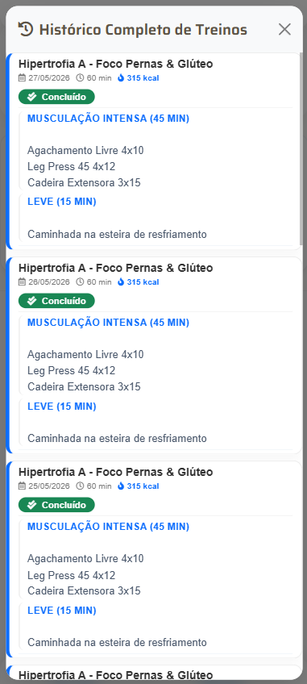 |
| **Evolução Antropométrica Comparativa:** Registro de medidas corporais com preservação automática do *Baseline Inicial*, permitindo demonstrar ao aluno ganhos reais de composição (ex: redução de gordura corporal de `26,00%` para `19,50%` e cintura de `84 cm` para `72 cm`). | **Rastreabilidade de Execução:** Log cronológico dos treinos concluídos pelo aluno com data, duração, gasto calórico creditado no diário nutricional e detalhamento das séries executadas. |

</details>

<details>
<summary><b>🏢 4. Módulo B2B Indústria Alimentícia — Retail Media, Pantry Big Data & Laboratório de P&D (8 Telas)</b></summary>
<br>

| Detecção Nutricional no PDV | Hub Público da Marca Pós-Scan | Ingrediente Patrocinado Nativo | Portal B2B: Catálogo & Quarentena |
| :---: | :---: | :---: | :---: |
| 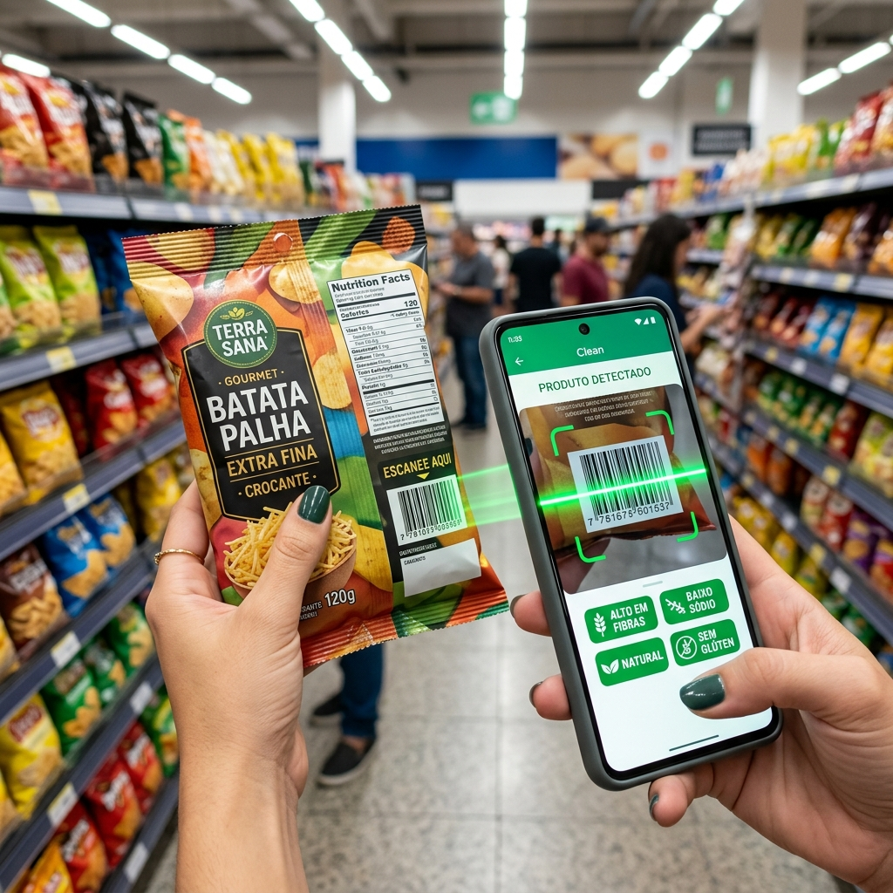 | 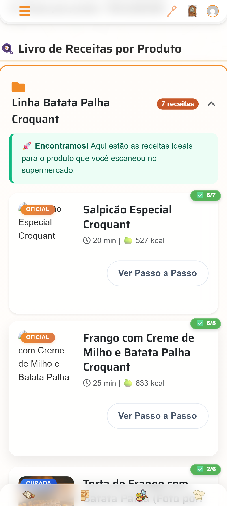 | 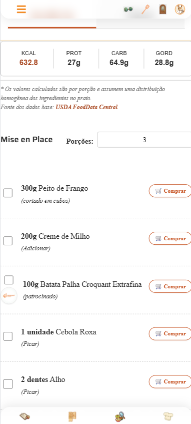 | 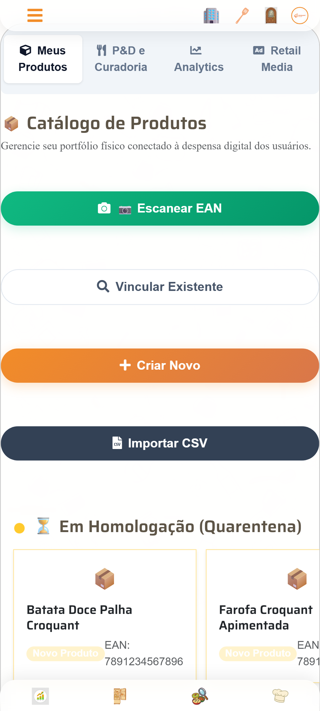 |
| **Decodificação Instantânea no Ponto de Venda:** Leitura rápida da embalagem física destacando selos nutricionais de decisão de compra (*Alto em Fibras*, *Baixo Sódio*, *Natural*, *Sem Glúten*). | **A Morte da Receita Estática:** Ao escanear o produto no mercado, o consumidor acessa o livro digital da linha com selos verdes (`5/7`, `5/5`) indicando quais receitas daquela embalagem ele já tem ingredientes em casa para preparar. | **Contextual Ad Placement:** Quando uma receita pede um insumo genérico, o item patrocinado (`100g Batata Palha Croquant Extrafina`) assume posição nativa no *Mise en Place* com identidade visual da marca e conversão direta. | **Governança de Catálogo EAN:** A indústria gerencia seu portfólio conectado à despensa digital via leitura de EAN, vínculo a produtos existentes, cadastro unitário ou importação em lote via CSV com fila de homologação (*Quarentena*). |

| Pantry Analytics & Big Data | Laboratório de P&D Culinário (Parser IA) | Gerenciador de Retail Media | Performance & CTR Regionalizado |
| :---: | :---: | :---: | :---: |
| 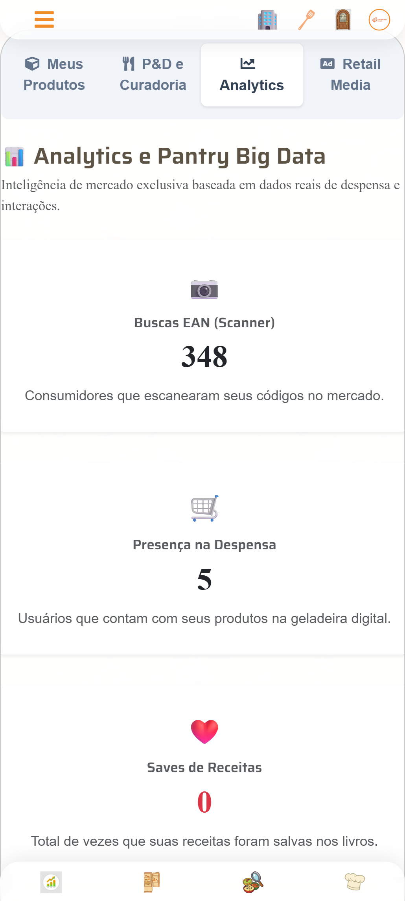 | 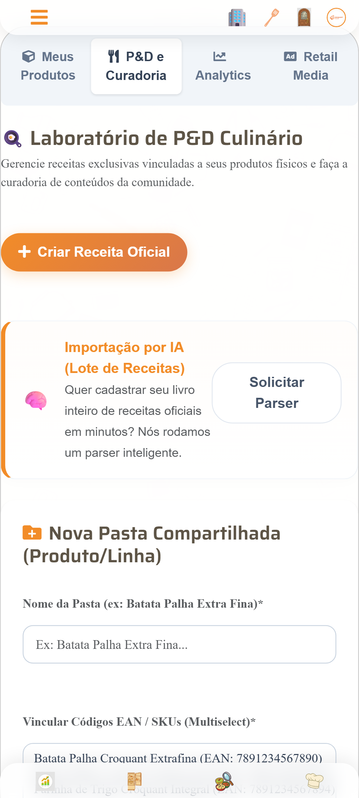 | 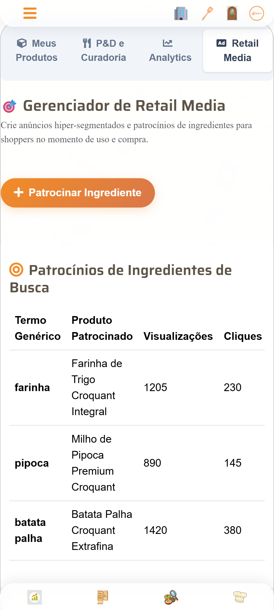 | 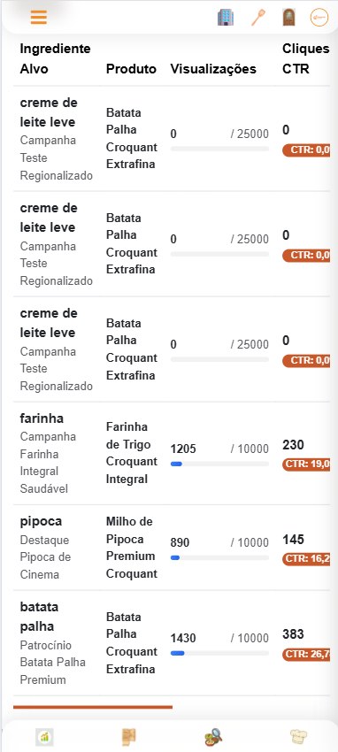 |
| **Inteligência de Despensa Real:** Métricas proprietárias de quantos consumidores escanearam o código EAN nos corredores de supermercado (`348 buscas`), presença ativa nas geladeiras digitais e retenção em livros de receitas. | **Engenharia de Receitas Assistida por IA:** Criação de receitas oficiais vinculadas a múltiplos códigos EAN/SKUs e ferramenta de *Importação por IA* para converter livros inteiros de receitas corporativas em fichas técnicas estruturadas. | **Patrocínio de Palavras-Chave Culinárias:** Marcas patrocinam termos genéricos de alta intenção (ex: `farinha`, `pipoca`, `batata palha`) para capturar a atenção do shopper no momento da busca e planejamento. | **Telemetria de Conversão & Geolocalização:** Acompanhamento granular de campanhas nacionais ou regionalizadas por UF/Cidade com contagem auditável de visualizações versus pacote contratado, cliques e taxas de conversão (*CTR* de até `26,7%`). |

</details>

---

## 🏗️ Arquitetura do Sistema & Fluxo de Dados

O diagrama abaixo ilustra como as camadas de captura *Offline-First*, motores determinísticos e agentes de IA interagem sem expor a integridade matemática das prescrições clínicas:

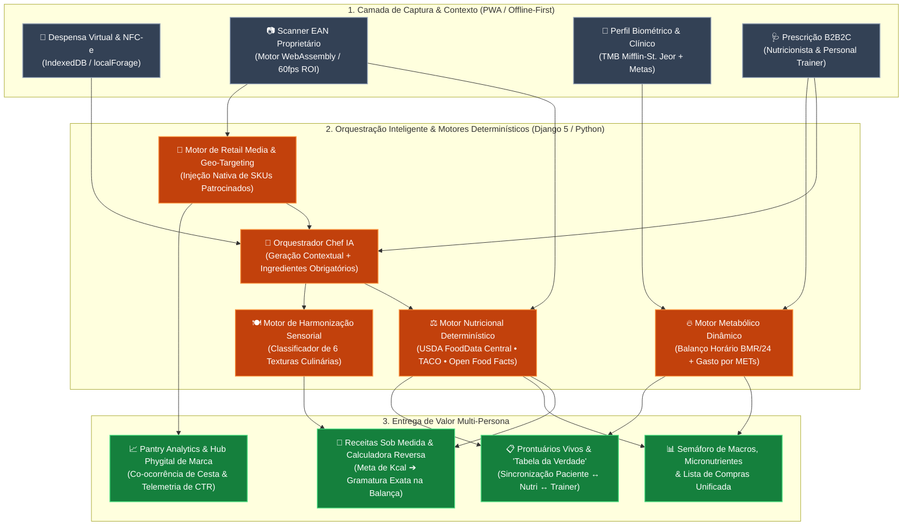

---

## 🧩 Matriz de Módulos e Capacidades

| Vertical / Módulo | Persona Alvo | Funcionalidades-Chave | Diferencial Técnico de Engenharia |
| :--- | :--- | :--- | :--- |
| **Chef IA & Despensa Virtual** | Consumidor (B2C) | Geração de receitas por estoque disponível, composições de prato e leitura de código de barras/NFC-e. | **Harmonizador Sensorial (`composer_engine`):** Valida contraste de texturas (*crocante, cremoso, firme, granuloso, líquido, fresco*) evitando pratos monótonos. |
| **Engenharia Nutricional & Diário** | Consumidor / VIP (B2C) | Calculadora reversa de porções, semáforo de 30 dias (OMS/ANVISA) e recomendação reversa de micronutrientes. | **Zero Alucinação Matemática:** LLMs estruturam o prato, mas os macros/micros são calculados deterministicamente via *USDA*, *TACO* e fatores de densidade física. |
| **Planejador & Compras** | Consumidor / Família (B2C) | Cardápio semanal integrado à despensa e lista de compras consolidada. | **Agregador Algébrico de Medidas:** Converte e soma medidas caseiras heterogêneas (colheres, xícaras, unidades) em gramatura líquida total. |
| **Consultório Digital** | Nutricionista (B2B2C) | Prontuário clínico, prescrição de pastas, ingredientes obrigatórios na IA e *tags* motivacionais ao vivo. | **Curto-Circuito Clínico:** Metas prescritas pelo nutricionista sobrescrevem automaticamente as equações padrão do aplicativo para o paciente vinculado. |
| **Performance & Biometria** | Personal Trainer (B2B2C) | *Workout Builder* por METs, *Tabela da Verdade (7 dias)* e histórico antropométrico com *baseline*. | **Orçamento Calórico Bidirecional:** O check-in de um treino prescrito recalcula o TDEE do aluno em tempo real, creditando calorias no diário alimentar. |
| **Business & Retail Media** | Indústria Alimentícia (B2B) | Hub público pós-scan EAN, *Pantry Analytics*, Laboratório P&D e patrocínio geolocalizado de ingredientes. | **SDK Proprietário em WebAssembly:** Leitura de códigos EAN a 60fps com recorte de ROI para embalagens plásticas curvas, amassadas e reflexivas. |
| **Academia Culinária (XP)** | Comunidade (B2C) | Trilhas de técnicas gastronômicas em vídeo, moderação de fotos reais de pratos e gamificação. | **Ledger Transacional de XP:** Motor de pontos com expiração programada (60 dias) e conversão automatizada de engajamento em assinatura Premium. |

---

## 🛠️ Decisões de Arquitetura & Engenharia (ADRs)

Esta seção documenta as principais decisões arquiteturais (*Architecture Decision Records*) tomadas durante o desenvolvimento do **Madam Oller**, evidenciando os *trade-offs* técnicos entre experiência do usuário, performance e segurança.

### ADR-001: Construção de SDK Proprietário de Leitura de Código de Barras em WebAssembly (WASM)
* **Contexto e Problema:** O fluxo de escanear produtos na despensa ou no corredor do supermercado é a porta de entrada tanto para a retenção do usuário B2C quanto para o hub de *Retail Media* B2B. Durante a fase de testes com bibliotecas públicas de mercado em JavaScript, todas apresentaram altas taxas de falha ao tentar ler códigos EAN impressos em **embalagens flexíveis, pacotes curvos, superfícies amassadas ou plásticos com reflexo de iluminação de gôndola**. Essa limitação degradava severamente a experiência do cliente — tornando a funcionalidade inútil na prática, já que era mais rápido digitar o nome do produto manualmente do que insistir em um leitor que não focalizava.
* **Decisão:** Desenvolvemos um SDK proprietário de visão computacional compilado para **WebAssembly (`MadamollerScanner.wasm`)** orquestrado por uma camada JavaScript dedicada. O motor opera em loop de `60fps` via `requestAnimationFrame`, realiza recorte dinâmico da Região de Interesse (*ROI de 70% × 40%* em `OffscreenCanvas`), transfere os buffers de imagem diretamente para o heap linear do WebAssembly (`HEAPU8` via `_malloc` e `_processFrame`) em duas passagens (leitura rápida contínua + *fallback* profundo a cada `250ms`) e controla o hardware do dispositivo (alternância de lentes, ativação de lanterna/*torch* para compensar sombras e feedback háptico).
* **Consequência:** Leitura quase instantânea mesmo em embalagens plásticas deformadas ou curvas, eliminando a fricção de entrada de dados na despensa e viabilizando a conversão *Phygital* dentro do supermercado.

### ADR-002: Adoção do Framework Django (Python) com Arquitetura Multi-Tenant e RBAC Robusto
* **Contexto e Problema:** A plataforma atende simultaneamente quatro perfis com requisitos estritos de isolamento de dados (`PERSONAL`, `NUTRITIONIST`, `PERSONAL_TRAINER` e `BUSINESS`) e manipula dados sensíveis de saúde protegidos pela LGPD (biometria, prontuários clínicos privativos e histórico alimentar), além de exigir integração direta com pipelines de IA e processamento científico de dados.
* **Decisão:** Utilizamos o **Django 5 (Python)** como núcleo da aplicação. A escolha baseou-se em dois pilares:
  1. **Compatibilidade nativa com o ecossistema Python de IA e Ciência de Dados** (`OpenAI`, `Pydantic`, `Pandas`, `NumPy`), permitindo que os motores de recomendação nutricional, parsers bromatológicos e agentes generativos rodem no mesmo runtime sem sobrecarga de serialização entre microsserviços.
  2. **Estrutura madura de segurança e permissões de usuário**, garantindo autenticação robusta, proteção nativa contra CSRF/XSS/SQL Injection, isolamento estrito de acesso a campos clínicos privados (como `clinical_notes` visíveis exclusivamente ao nutricionista autor) e mecanismos de defesa ativa (incluindo *Honeypot* de autenticação com rastreamento de IP/User-Agent).
* **Consequência:** Segurança de nível corporativo para as contas dos usuários e velocidade de entrega de novas verticais B2B2C/B2B sob uma base de código coesa e auditável.

### ADR-003: Arquitetura PWA Offline-First com Optimistic UI e Fila Assíncrona em IndexedDB (`localForage`)
* **Contexto e Problema:** Cozinhas residenciais e corredores internos de supermercados são zonas clássicas de sombra de sinal móvel (3G/4G instável). Em uma arquitetura web tradicional síncrona, marcar um item na lista de compras ou adicionar um ingrediente à despensa sem conexão resulta em travamento de tela ou perda de estado.
* **Decisão:** Implementamos uma arquitetura **Offline-First Progressive Web App (PWA)** regida por duas diretrizes estritas:
  * **Optimistic UI:** Toda interação de botão (adicionar/remover ingrediente, marcar item comprado, concluir treino) atualiza o estado visual do DOM de forma imediata e síncrona (`<16ms`).
  * **Persistência Assíncrona Resiliente:** As mutações de rede ocorrem em background. Em caso de perda de conectividade, um motor de sincronização intercepta a falha silenciosamente e persiste a operação em uma fila transacional no **IndexedDB** via **`localForage`** (escolhido em detrimento do `localStorage` para evitar o limite rígido de 5MB e o bloqueio síncrono da *main thread* do navegador). Quando o evento `online` é restaurado, a fila (`syncQueue`) é drenada automaticamente.
* **Consequência:** Experiência de aplicativo nativo com zero percepção de latência pelo usuário final, independentemente da qualidade da conexão.

### ADR-004: Pipeline Híbrido de IA Generativa + Cálculo Nutricional Determinístico (Anti-Alucinação)
* **Contexto e Problema:** Modelos de Linguagem (LLMs) são excepcionais para criatividade gastronômica e adaptação de técnicas culinárias, mas sofrem de alucinação aritmética quando solicitados a calcular calorias, macronutrientes e micronutrientes exatos de uma receita.
* **Decisão:** Desacoplamos a geração criativa da validação bromatológica. O agente de IA gera a estrutura culinária e as quantidades, mas o cálculo nutricional é executado por um **Motor Determinístico em Python** que:
  1. Extrai e normaliza gramaturas e medidas caseiras via expressões regulares e fatores físicos de densidade (`g/ml`) e peso médio por unidade.
  2. Executa resolução de entidades em 3 camadas (*Match Exato* ➔ *Dicionário Regional de Sinônimos Culinários Brasileiros*, ex: `macaxeira`/`aipim` → `mandioca`, `jerimum` → `abóbora` ➔ *Fuzzy Matching*) sobre bases científicas homologadas (**USDA FoodData Central**, **Tabela TACO** e **Open Food Facts**).
* **Consequência:** Criatividade infinita na cozinha combinada com precisão clínica auditável para nutricionistas e pacientes.

### ADR-005: Motor de Balanço Energético Horário (Mifflin-St. Jeor + METs Sem Dupla Contagem)
* **Contexto e Problema:** Aplicativos fitness comuns somam as calorias brutas de um exercício diretamente à Taxa Metabólica Basal (TMB) diária integral, inflando artificialmente o gasto calórico (pois esquecem de descontar a TMB basal que o corpo já gastaria durante aquela hora em repouso).
* **Decisão:** O método `calculate_dynamic_tdee` decompõe o dia em 1440 minutos (`24 horas`). Ele calcula a taxa basal horária (`BMR / 24`), subtrai a duração exata dos treinos registrados no dia e aplica a equação:
  $$\text{TDEE Real} = \sum (\text{MET} \times \text{Peso}_{\text{kg}} \times \text{Horas}_{\text{treino}}) + \left(\frac{1440 - \text{Minutos}_{\text{treino}}}{60} \times \frac{\text{TMB}}{24}\right)$$
* **Consequência:** Eliminação de erros matemáticos de superestimação de gasto calórico, entregando aos Personal Trainers e Nutricionistas uma "Tabela da Verdade" bioenergeticamente exata.

---

## 📂 Estrutura deste Repositório (Showcase)

```text
madamoller-showcase/
├── README.md                                                     # Case Study Arquitetural, Produto & UX
└── docs/
    └── screenshots/                                              # Curadoria Visual Padronizada (Mock Data)
        ├── 00-logo-madamoller.png                                # Identidade Visual Oficial
        ├── 01-diario-painel-nutricional.png                      # [B2C] Visão Diária, Macros e Hidratação
        ├── 02-diario-balanco-calorico-integrado.png              # [B2C/B2B2C] Balanço Calórico + Tag da Nutri
        ├── 03-receita-calculadora-reversa-porcoes.png            # [B2C] Calculadora Reversa (Kcal -> Gramas)
        ├── 04-relatorio-mensal-semaforo-nutricional.png          # [B2C] Relatório Mensal OMS/ANVISA
        ├── 05-inteligencia-micronutrientes-recomendacao.png      # [B2C] Recomendação Reversa de Micronutrientes
        ├── 06-receita-visao-geral-macros.png                     # [B2C] Detalhe de Receita e Macronutrientes
        ├── 07-receita-mise-en-place-despensa.png                 # [B2C] Mise en Place com Match de Despensa
        ├── 08-receita-ficha-tecnica-usda.png                     # [B2C/B2B] Ficha Técnica Auditada USDA
        ├── 09-planejador-semanal-carga-prescrita.png             # [B2C/B2B2C] Planejador Semanal + Carga Nutri
        ├── 10-lista-compras-unificada-inteligente.png            # [B2C] Lista de Compras Unificada (Soma em g)
        ├── 11-nutri-dashboard-pacientes.png                      # [B2B2C Nutri] Dashboard Clínico de Pacientes
        ├── 12-nutri-diario-semanal-paciente.png                  # [B2B2C Nutri] Raio-X Semanal do Paciente
        ├── 13-nutri-biblioteca-protocolos-clinicos.png           # [B2B2C Nutri] Biblioteca de Pastas Clínicas
        ├── 14-nutri-pasta-prescrita-match-despensa.png           # [B2B2C Nutri] Pasta Prescrita no App Paciente
        ├── 15-trainer-dashboard-gestao-alunos.png                # [B2B2C Trainer] Gestão de Carteira de Alunos
        ├── 16-trainer-tabela-da-verdade-7dias.png                # [B2B2C Trainer] Tabela da Verdade (7 Dias)
        ├── 17-trainer-workout-builder-mets.png                   # [B2B2C Trainer] Workout Builder Pro (METs)
        ├── 18-trainer-prontuario-biometria-hipertrofia.png       # [B2B2C Trainer] Prontuário de Biometria
        ├── 19-trainer-historico-treinos-concluidos.png           # [B2B2C Trainer] Histórico de Treinos
        ├── 20-b2b-scanner-ean-supermercado.png                   # [B2B Marcas] Scanner EAN WASM no Supermercado
        ├── 21-b2b-scanner-deteccao-nutricional.png               # [B2B Marcas] Detecção de Selos no PDV
        ├── 22-b2b-hub-publico-receitas-marca.png                 # [B2B Marcas] Hub Público Pós-Scan com Match
        ├── 23-b2b-receita-ingrediente-patrocinado.png            # [B2B Marcas] Ingrediente Patrocinado Nativo
        ├── 24-b2b-dashboard-catalogo-homologacao.png             # [B2B Marcas] Catálogo EAN e Quarentena
        ├── 25-b2b-pantry-analytics-big-data.png                  # [B2B Marcas] Pantry Analytics & Big Data
        ├── 26-b2b-laboratorio-pd-importacao-ia.png               # [B2B Marcas] Laboratório P&D e Parser IA
        ├── 27-b2b-retail-media-keywords.png                      # [B2B Marcas] Gerenciador de Retail Media
        └── 28-b2b-retail-media-performance-ctr.png               # [B2B Marcas] Telemetria e CTR Regionalizado
```

---

## 🔒 Nota de Propriedade Intelectual & Governança

> **Aviso Legal:** O **Madam Oller** é um produto comercial proprietário. Por razões estratégicas, comerciais e de proteção de propriedade intelectual (incluindo o código-fonte do motor WebAssembly de leitura óptica, heurísticas de harmonização culinária, modelos de dados e integrações B2B), o repositório principal de produção permanece **privado**.
>
> Este repositório público foi elaborado exclusivamente como **Showcase e Estudo de Caso Arquitetural (Case Study)** para demonstrar decisões de engenharia de software, design de produto, modelagem de ecossistemas B2B2C/B2B e capacidade de execução técnica ponta a ponta. Todos os nomes de pacientes, profissionais e marcas exibidos nas capturas de tela são dados sintéticos (*mockados*) criados para fins de demonstração.

---

<div align="center">

**Desenvolvido por [Adam Moller](https://github.com/Adam-Moller)**  
*Engenharia de Produto • Arquitetura Full-Stack • AI-Native Applications*

</div>
